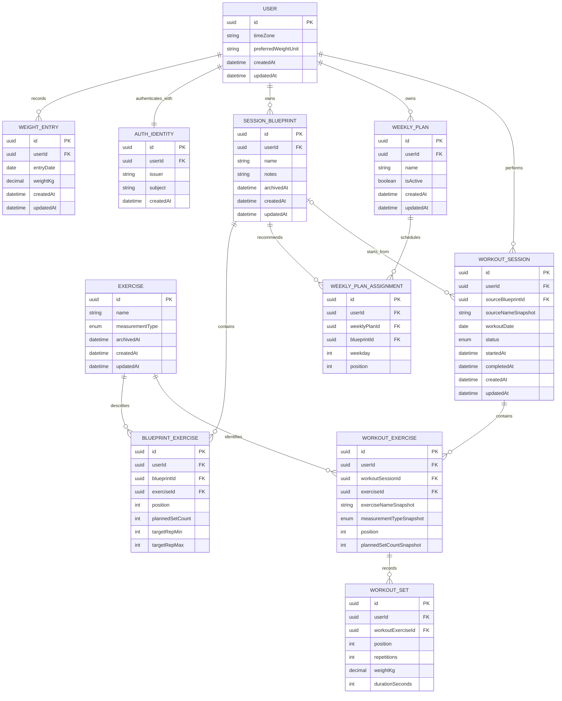

# Backend Data Model

**Status:** V1 domain model proposal; product decisions confirmed  
**Scope:** PostgreSQL and Prisma persistence for accounts, body-weight history, reusable workout plans, and completed workouts.

This proposal follows [`vision.md`](vision.md), [`general_design.md`](general_design.md), and the product/domain constraints in `AGENTS.md`. Auth0 is selected for identity; hosting and deployment remain open. This is a domain design, not a final migration plan.

## Design principles

- Every user-owned row has a `userId`. Backend queries always derive the user from the authenticated request; clients cannot select another owner by passing an ID. The shared exercise catalog is global and is not user-owned.
- Use UUID primary keys, UTC timestamps for events, and calendar `DATE` values for daily records.
- Preserve the distinction between reusable plans and performed workouts. Editing a plan must not rewrite a past or in-progress workout.
- Keep exercise measurement type fixed. Historical workout rows also retain a snapshot of the exercise name and measurement type as recorded when the workout was created.
- Archive reusable items instead of deleting them when history or plans refer to them.
- Persist decimal measurements without floating-point rounding. Store load and body weight in kilograms; convert for display according to user preference.
- Public weight and load API values include an explicit `KG` or `LB` unit. Convert pounds using the exact factor `1 lb = 0.45359237 kg`, then round half up to the nearest `0.001 kg` for persistence. Write responses use the submitted unit. Read responses include their unit and use an explicitly requested unit or the user's preferred unit when none is requested.

## Entity relationship diagram

The Mermaid source is embedded here so the relationship diagram stays editable with the design document and can be rendered by Mermaid-compatible tools.

## Proposed entities

### User

Represents an application account and the ownership boundary for all personal data.

| Field | Type | Rules |
|---|---|---|
| `id` | UUID | Primary key |
| `timeZone` | IANA time-zone string | Declared at account creation and immutable afterward; used to assign daily entries and weekday schedules |
| `preferredWeightUnit` | Enum (`KG`, `LB`) | Presentation preference; stored values remain kilograms |
| `createdAt`, `updatedAt` | Timestamp | UTC |

### AuthIdentity

Maps one LiftMetrics account to its Auth0 identity, so authentication remains separate from ownership of domain data. Keep Auth0's identifiers as strings; they are opaque provider values, not UUIDs.

| Field | Type | Rules |
|---|---|---|
| `id` | UUID | Primary key |
| `userId` | UUID | Required unique reference to `User`; one Auth0 identity per LiftMetrics account for the initial release |
| `issuer` | String | Auth0 tenant issuer URI (`iss` claim) |
| `subject` | String | Auth0 user identifier from the `sub` claim |
| `createdAt` | Timestamp | UTC |

Unique constraint: `(issuer, subject)`. Do not link accounts by email. Account linking is outside the initial scope; adding another identity later must require an explicit authenticated linking flow. Do not store passwords, access tokens, refresh tokens, or provider secrets in this table.

During account creation, the client completes Auth0 authentication, collects the required time zone, and sends a first-account request. The backend validates the access token, then creates `User` and `AuthIdentity` together in one transaction. The React client requests an access token for the LiftMetrics API audience. NestJS validates the JWT signature, issuer, and audience, then maps its trusted `(iss, sub)` pair to `AuthIdentity` and `User`. Configure the issuer and API audience outside the database. Auth0 documents that its user identifier is returned in the OIDC `sub` claim and that requesting an API audience yields a JWT access token. ([Auth0 `sub` claim](https://support.auth0.com/center/s/article/User-ID-listed-as-SUB), [Auth0 access-token format](https://support.auth0.com/center/s/article/opaque-versus-jwt-access-token))

The local `User` table does not copy the Auth0 email because the current product has no email-based feature; account recovery and verified email remain with Auth0. Add local contact data only if a product feature needs it.

### Auth0 free-tier note (reviewed 2026-10-30)

Auth0 is selected for the initial release. Its official pricing page currently lists a Free plan at $0/month for up to 25,000 monthly active users, including passwordless and social connections. Custom-domain use requires credit-card verification, and exceeding the free allowance requires a paid plan. These are current plan terms, not a promise of zero cost forever; the app also has separate hosting, domain, email, and database costs. See [Auth0 pricing](https://auth0.com/pricing).

### WeightEntry

One corrected, current body-weight value per user and calendar day.

| Field | Type | Rules |
|---|---|---|
| `id` | UUID | Primary key |
| `userId` | UUID | Required owner |
| `entryDate` | Date | User-local calendar date |
| `weightKg` | Decimal(7,3) | Greater than zero; canonical kilograms, with 1 g storage precision |
| `createdAt`, `updatedAt` | Timestamp | UTC; updates support correction |

Unique constraint: `(userId, entryDate)`. Create-or-update behavior for that key supports correcting a prior entry. The entry date is the calendar date in the user's declared time zone. Since that time zone cannot change, later profile edits cannot move an entry across days. API create/correction requests include an explicit `unit` (`KG` or `LB`) beside the decimal value; the service converts to canonical kilograms before persistence.

### Exercise (shared catalog)

An exercise in a single global catalog available to every user. For the initial release, catalog rows are loaded and maintained through version-controlled backend seed data; there is no end-user exercise CRUD or catalog admin UI.

| Field | Type | Rules |
|---|---|---|
| `id` | UUID | Primary key; no `userId` |
| `name` | String | Required, trimmed; unique after case and whitespace normalization |
| `measurementType` | Enum (`REPS_AND_WEIGHT`, `TIME`) | Immutable after creation |
| `archivedAt` | Timestamp? | Archived exercises cannot be newly selected, but remain available to existing routines and history |
| `createdAt`, `updatedAt` | Timestamp | UTC |

The catalog must not allow changing measurement type after an exercise has been referenced. If a definition needs a different type, add a new catalog exercise and archive the old one.

### SessionBlueprint and BlueprintExercise

`SessionBlueprint` is a reusable routine. `BlueprintExercise` is its ordered exercise list and prescription. Both are user-owned; referenced exercises come from the global catalog.

| Entity / field | Rules |
|---|---|
| `SessionBlueprint.id`, `userId` | UUID primary key and owner |
| `name` | Required; not necessarily unique |
| `notes` | Optional free text |
| `archivedAt` | Optional archive timestamp |
| `BlueprintExercise.position` | Zero-based or one-based ordering; unique within a blueprint |
| `BlueprintExercise.plannedSetCount` | Positive integer |
| `targetRepMin`, `targetRepMax` | Optional, only valid for `REPS_AND_WEIGHT`; when present, min must be positive and max >= min |
| `BlueprintExercise.exerciseId` | Must refer to an active catalog exercise when editing the blueprint |
| `(blueprintId, exerciseId)` | Unique; the same exercise cannot appear twice in a routine |

Timed exercise prescriptions are not defined in the current product notes. The initial model does not add a target duration until that behavior is decided.

### WeeklyPlan and WeeklyPlanAssignment

`WeeklyPlan` groups recurring recommendations. `WeeklyPlanAssignment` assigns a blueprint to a weekday. Exactly one plan may be active for a user; multiple assignments on a weekday are allowed and ordered.

| Field | Rules |
|---|---|
| `WeeklyPlan.isActive` | At most one active plan per user (enforce with a partial unique index in a SQL migration) |
| `weekday` | ISO weekday integer 1–7 (Monday–Sunday), interpreted in the user's time zone |
| `position` | Ordering among that day's recommendations; unique with `(weeklyPlanId, weekday, position)` |
| `weeklyPlanId`, `blueprintId`, `userId` | All records must belong to the same user |

### WorkoutSession, WorkoutExercise, and WorkoutSet

These entities describe what the user actually did. Starting a recommendation copies its exercise rows and planned values into a workout; later template edits do not affect that workout. Unscheduled workouts are also allowed. The user can add, remove, reorder, or change exercises and sets, choosing exercises from the shared catalog. The same exercise cannot appear twice in one workout, and each user may have at most one in-progress workout.

| Entity / field | Rules |
|---|---|
| `WorkoutSession.sourceBlueprintId` | Optional reference to the source routine; nullable for an ad hoc workout |
| `sourceNameSnapshot` | Routine name at start, for stable history display |
| `workoutDate` | User-local calendar date; supports review/correction independent of timestamp |
| `status` | `IN_PROGRESS` or `COMPLETED`; unfinished workouts remain in progress until resumed or deleted |
| `startedAt`, `completedAt` | UTC instants; `completedAt` set when completed |
| `WorkoutExercise.exerciseId` | Required reference to the shared catalog |
| `(workoutSessionId, exerciseId)` | Unique; the same exercise cannot appear twice in a workout |
| `exerciseNameSnapshot`, `measurementTypeSnapshot` | Captured at start/add time. Measurement snapshot must match the referenced exercise at that time |
| `position` | Unique ordering within the workout |
| `plannedSetCountSnapshot` | Optional starting recommendation retained for comparison; actual sets are rows below |
| `WorkoutSet.position` | Unique ordering within the workout exercise |
| `repetitions`, `weightKg` | Required for `REPS_AND_WEIGHT`; repetitions > 0 and weight >= 0 (zero is valid) |
| `durationSeconds` | Required for `TIME`; positive integer |

The `WorkoutSet` measurement columns are mutually exclusive: repetitions-and-weight rows have repetitions and weight and no duration; time rows have duration and no repetitions or weight. The server validates this, and PostgreSQL `CHECK` constraints should enforce it too. PostgreSQL checks cannot inspect a parent row directly, so the migration can enforce column shape while the domain service enforces that the set shape matches its parent's `measurementTypeSnapshot`.

## Relationships and database constraints

Use composite foreign keys to make ownership mismatches impossible at the database layer as well as in service code. Expose `UNIQUE (userId, id)` on user-owned parent tables and reference `(userId, parentId)` from child rows. Global catalog exercise references use `exerciseId` without a user owner. Prisma supports compound unique constraints; where its schema cannot express the desired check or partial index, add SQL in the Prisma migration.

Recommended constraints and indexes:

- `WeightEntry`: unique `(userId, entryDate)`; index `(userId, entryDate DESC)` for history.
- `AuthIdentity`: unique `(issuer, subject)` and unique `userId` (one Auth0 identity per LiftMetrics account initially).
- `Exercise`: unique normalized name (for example via a SQL index over `lower(trim(name))`).
- `BlueprintExercise`: unique `(blueprintId, position)` and `(blueprintId, exerciseId)`; same-user composite reference to its blueprint.
- `WeeklyPlan`: partial unique `(userId) WHERE isActive = true`.
- `WeeklyPlanAssignment`: unique `(weeklyPlanId, weekday, position)`; check weekday in 1–7 and position >= 0.
- `WorkoutSession`: index `(userId, workoutDate DESC)` and partial unique index on `(userId) WHERE status = 'IN_PROGRESS'`.
- `WorkoutExercise`: unique `(workoutSessionId, position)` and `(workoutSessionId, exerciseId)`; same-user composite reference to its workout and a global catalog reference for exercise.
- `WorkoutSet`: unique `(workoutExerciseId, position)`; check value shape and valid ranges.
- Use `RESTRICT` for referenced exercise/blueprint deletion; archive reusable rows instead. Owner deletion of a workout removes its exercise and set children in the same transaction. Account deletion hard-deletes all user-owned records, including weight history, plans, workouts, and the local Auth0 identity mapping.

## Ownership and write behavior

- Derive `userId` from the authenticated principal, never from a request body as authority.
- Scope every read, update, and delete by `(id, userId)`; return a non-disclosing not-found response for foreign IDs.
- Validate ownership for every nested user-owned reference before writing; composite foreign keys provide a final guard against cross-user references. Archived catalog exercises cannot be newly selected for routines or manually added to a workout; starting an existing routine may still carry its archived exercises into the workout snapshot.
- Create a workout and its copied exercise/set recommendations in one transaction.
- Reordering should update positions atomically to avoid transient unique-key conflicts (for example, use a temporary offset or deferred SQL constraints).
- Keep correction and owner-delete operations for weight entries and workout records. For account deletion, hard-delete all personal data from LiftMetrics and delete the corresponding Auth0 identity. Since the database and Auth0 cannot share a transaction, use a retryable deletion workflow; retain only the minimum Auth0 identifier in a short-lived outbox/task record until remote deletion succeeds, then remove that record.

## Remaining implementation work

No product-level model decisions remain open. Before implementing the schema and account flows:

- Configure separate Auth0 applications/API audiences for each deployment environment and keep tenant issuer, API audience, and client IDs in deployment configuration.
- Use the proposed version-controlled exercise inventory in [`feature_docs/exercise_catalog_seed.md`](feature_docs/exercise_catalog_seed.md) as the initial catalog seed; keep additions and corrections explicit and version controlled.
- Implement account deletion as a retryable cross-service workflow so local personal data and the corresponding Auth0 account are both deleted even if either side is temporarily unavailable.
- Establish any legal or operational requirements for audit records before adding retained audit data. Such records must not retain workout, weight, or profile data after account deletion.

## Prisma implementation notes

- Suggested enums: `ExerciseMeasurementType`, `WeightUnit`, and `WorkoutStatus` (`IN_PROGRESS`, `COMPLETED`). Auth0 issuer/audience and client IDs are deployment configuration, not database rows.
- Use `Decimal` for weight and load values; do not convert to JavaScript `number` before persistence or comparison where precision matters.
- Model calendar-only values as PostgreSQL `DATE` (Prisma `DateTime @db.Date`) and event times as `TIMESTAMPTZ`.
- Add SQL migration checks for workout-set shape, numeric ranges, active-plan and in-progress-workout uniqueness, and normalized catalog names. Set user-owned foreign keys to cascade on account deletion; prevent time-zone changes in the account update service, with an optional database trigger as an additional guard.
- Keep REST DTOs separate from Prisma models. In particular, never accept `userId` as an authorization decision from the client.
