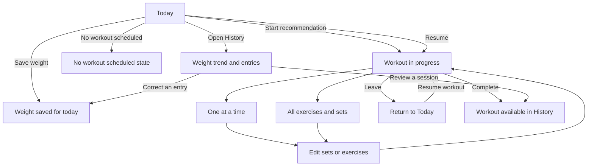

# Feature 2: Mobile-first frontend design

## Goal

Design and build the LiftMetrics frontend around the already implemented backend. Start with mobile-first interaction and visual design, explore the important screen flows in prototypes, then implement the agreed direction as a client-rendered React and TypeScript application.

The current design anchor is [`visual_design_reference.md`](../Visual%20Design%20Reference/visual_design_reference.md) and its linked dark mobile prototype. The prototype is an exploration artifact, not production code. The user has accepted Today and History as the starting visual direction; workout navigation and management details remain open for implementation planning.

## Design handoff for implementation planning

Use this section, the product rules below, and the linked prototype together as the starting package for a new implementation agent. Plan the production frontend from scratch in the approved React/TypeScript architecture. The standalone prototype demonstrates visual direction and some interactions; it is not the application architecture or a source of production data behavior.

### Carry forward as the current design baseline

- **Phone first, dark theme.** Use a calm charcoal palette, restrained warm accent, legible type, comfortable spacing, and touch-friendly controls. Design phone layouts first, then adapt them to wider screens.
- **Today is the leading approved candidate.** Keep the compact weight-entry area and a clear scheduled or in-progress workout card. Show the complete exercise list and the main workout action together on a typical phone screen without scrolling. Remove motivational intro copy and redundant date headings. Preserve enough spacing and hierarchy that the compact layout still feels intentional.
- **History is a strong approved candidate.** Keep weight trend and dated entries as its core. Let users reach workout records through **History → All workouts**; do not add a separate Sessions destination in the main navigation.
- **Workout recording is a useful starting direction, not settled.** Preserve the concepts of a focused exercise view and a whole-workout overview so the implementation plan can decide whether to keep both, combine them, or simplify navigation. Keep the overview of exercises and sets discoverable while recording.
- **Plan is the home for plan and saved-workout management.** The prototype direction is to select or create the active weekly plan, edit its weekday schedule, and create or edit reusable saved workouts from one Plan area. This is a reasonable starting flow, not a claim that all edge cases or details are resolved.

### Intended product flows

1. **Today:** Show today's weight and either the active plan's workout recommendation, an in-progress workout to resume, or a clear no-workout state. Starting a recommendation creates a separate workout record from the recommendation. If several workouts are scheduled for today, the user can choose which one to start. Weight recording stays available regardless of workout state.
2. **Plan and saved workouts:** A user chooses the active weekly plan, edits assignments for weekdays, and can assign saved workouts (including more than one to a day in the current prototype). A saved workout is a reusable recipe with ordered exercises, planned set counts, and optional targets. Rest days and unscheduled days must be representable. Changes to a recipe do not rewrite a workout already started from it.
3. **Workout recording:** The user can start, edit, leave and resume, and complete a workout. A workout begins from a copy of its recommendation, then can diverge as exercises, order, set count, and recorded values are changed. Completion makes the workout available in History.
4. **History:** The user reviews and corrects dated weight entries and opens **All workouts** to inspect a completed workout's date, completion state, exercise order, and recorded sets.

### Prototype boundaries and known gaps

The reference at [`docs/design-prototypes/feature_2/index.html`](../design-prototypes/feature_2/index.html) is a standalone visual prototype. Its plan and saved-workout edits use browser local storage; its workout and history content uses sample data. It does not authenticate, call the backend, or persist real user records. Treat every sample value and local-storage record as disposable demo state. Do not port its single-file structure into production.

Some edge cases are intentionally unresolved and should not block implementation planning. Revisit them while mapping the real API and building the flows: multiple recommendations on one day, plan activation and empty-plan behavior, edits to a saved workout while a workout based on it is in progress, date and time-zone boundaries, long lists and history paging, validation and network failures, and exercise selection. The prototype may not handle each case correctly.

### Starting checklist for the implementation agent

- Read [`docs/vision.md`](../vision.md), [`docs/general_design.md`](../general_design.md), this feature document, and the visual reference before changing product behavior.
- Inspect the existing React/frontend setup, API documentation/OpenAPI, and backend response shapes. Map each accepted flow to existing routes and note concrete contract gaps before proposing changes.
- Plan the production frontend from a clean application structure with React, TypeScript, React Router Framework Mode in client-rendering mode, same-origin REST calls, and Auth0 configuration as specified below.
- Replace prototype-only local storage and sample records with authenticated API state. Keep ownership and validation enforcement in the backend.
- Start planning from the approved Today and History direction; keep the workout interaction and detailed Plan behavior explicit as decisions to resolve, rather than silently treating prototype behavior as final.

## Scope

- Establish and document the visual and interaction design for the daily experience, weight history, and workout recording.
- Explore workout navigation patterns, including a per-exercise entry flow and a view where users can see more of the workout and its sets together.
- Define the screen map and navigation after evaluating which destinations users need most often.
- Explore and review the weekly-plan and saved-workout flows after the primary daily and history flows. The Plan interactions are working prototype flows with sample data, not an approved production design.
- Implement the approved frontend with React, TypeScript, and React Router Framework Mode, configured for client rendering without runtime server-side rendering.
- Connect the client to the existing same-origin REST API, use the selected Auth0 identity provider, and handle loading, empty, validation, and error states.
- Keep the frontend usable on both phones and PCs while designing for a phone viewport first.

## Out of scope

- Backend domain changes or new summary/report endpoints. Use the existing API and document any genuine API gap before proposing a backend change.
- Offline entry and synchronization.
- Spreadsheet import or export.
- Treating the current prototype's sample data or placeholder interactions as production behavior.
- Finalizing low-priority Plan, routine-library, or session-history navigation before the primary flows have been reviewed.

## Product rules the interface must preserve

- The main Today screen contains the two daily actions: record or correct today's body weight, and see the workout recommended for today or the workout already in progress. Do not add charts, weekly summaries, or recent history to this screen.
- Weight entries belong to a user's local calendar day and can be corrected later. Show the configured weight unit and allow the measurement input to follow the user's preference.
- A scheduled workout is a recommendation. Users can change exercises, order, set count, and recorded values while training.
- Each exercise has one fixed measurement type: repetitions plus weight, or time. Do not offer repetitions-only exercises. Zero load is valid for repetitions-plus-weight exercises.
- A started workout can be resumed. Completing a workout makes it available in history.
- All personal data and actions are scoped to the authenticated user by the backend.
- The initial release is online-only.

## Screen and flow design

### 1. Today

**Priority:** Primary; approved starting direction.

Show today's weight entry and the workout card, with only the compact date context needed to make the day clear. Avoid a large or redundant date heading. When a workout is in progress, make resume the main workout action. When nothing is scheduled, provide a clear no-workout state without inventing a recommendation. Saving or correcting today's weight should confirm success and show useful validation when the value is missing or invalid.

Keep the visual hierarchy and compact mobile layout from the current prototype as the starting point. Omit motivational intro copy and a redundant date heading. On Today, show the full scheduled exercise list by default, including on phones. Use deliberate spacing and clear card hierarchy while keeping a typical six- or seven-exercise workout plus its start action visible without scrolling. Do not treat the prototype's exact copy, styling, or sample values as final requirements.

### 2. Workout recording

**Priority:** Primary; interaction model remains open.

Design the complete start, record, modify, resume, and complete flow. The design exploration must compare at least these ways to move through a workout:

1. Focus on one exercise at a time, with an obvious next/previous path and visible workout progress.
2. Show the ordered exercise list and let a user open or expand exercises to enter their sets, so the user can see more of the workout without repeated navigation.

In either direction, show the current exercise's measurement type and planned target when present. Provide clear controls to add or remove sets, record repetitions and load or time, and mark sets complete. Let users add, remove, replace, and reorder exercises without losing already entered values. Include a safe way to leave and resume an in-progress workout, and a completion state that leads to the saved session.

The prototype should make navigation and editing interactions explorable. It must not imply that sample edits are persisted to the backend.

### 3. History

**Priority:** Primary; approved as a strong starting direction.

Design weight progression, a dated weight-entry list, correction of a past entry, and access to completed workout history. Keep history off Today. Explore how a user reaches a workout's recorded exercises and sets without making the history view feel crowded on a phone.

The current dark chart and entry list can be used as the baseline. Chart ranges, pagination, edit affordances, and workout detail remain subject to interaction review.

### 4. Weekly plan and reusable routines

**Priority:** Secondary; current prototype screens are not approved.

Explore how users create and edit reusable workout sessions, assign one or more sessions to days, reorder sessions on a day, and activate or change a weekly plan. Keep recommendation behavior understandable when a day has no scheduled workout or more than one session. The design should explain that a plan is a starting point and does not lock the user into a fixed workout.

The current proposal groups the weekly schedule and saved workouts under **Plan**. Review whether this grouping and the schedule editor are clear before implementation.

The current prototype now treats **Plan** as the place to switch the active weekly plan, edit which saved workout is recommended on each weekday, and create or edit reusable workouts. These interactions persist in browser local storage for exploration only; they are not connected to the account or backend. The production API already supports plan list/create/read/update/activate/deactivate through `/api/weekly-plans`, reusable workout create/list/read/update/archive through `/api/session-blueprints`, and today's recommendation through `/api/weekly-plans/recommendation/today`.

### 5. Workout history and session details

**Priority:** Secondary; the separate Sessions tab has been removed from the prototype. Workout records are reached through History → All workouts.

Workout history is presented as a section under History. A workout detail should make the workout date, completion state, ordered exercises, measurement types, and recorded sets easy to review. The production API already supports workout listing and individual record details through `GET /api/workout-sessions` and `GET /api/workout-sessions/:id`. Starting from a recommendation with `POST /api/workout-sessions/from-recommendation/:assignmentId` copies its exercise prescription into a separate workout record; `PUT /api/workout-sessions/:id` saves workout edits and `POST /api/workout-sessions/:id/complete` marks it complete. Later edits to a saved workout do not rewrite an existing workout record. The current history entries are sample records used to demonstrate that review flow.

## Primary user flows to design

### Record today's weight and choose today's workout

Today shows the current day's weight and either the scheduled workout recommendation or an in-progress workout to resume. Saving the weight confirms the result on Today. Starting or resuming a workout opens workout recording. If no workout is scheduled and none is in progress, show a calm empty state and leave weight recording available.

### Record and complete a workout

Start from the Today recommendation or resume an in-progress session. The workout prototype exposes two modes for review: **One at a time**, which focuses on the current exercise, and **All exercises**, which shows the ordered exercise list and set values together. In either mode, users can change sets and exercises, move through the session, leave and resume it, and complete it. Completion returns to the daily screen and makes the session available in history.

### Review and correct history

Open History from the main navigation, review the weight trend and dated entries, then open a specific entry to correct its date's value. From History, continue to a completed workout and review its recorded exercises and sets. The final design should make it clear which date an edit will change.

The prototype uses sample data, so these interactions demonstrate the intended flows only; they do not save records to the backend.

## Design deliverables

The current prototype fulfills the visual exploration stage for the initial direction. The remaining design work is to resolve the decisions listed below during implementation planning and to refine any flow that proves unclear against the real API; do not restart the approved Today and History explorations without a concrete usability or API reason.

- A reviewed mobile-first Today design and responsive adaptation for wide screens.
- A workout flow prototype that exposes the exercise-navigation alternatives and the set-entry, exercise-editing, resume, and completion interactions.
- A reviewed History design covering weight progression, dated entries, corrections, and access to workout records.
- Clearly marked exploratory designs for weekly-plan and routine management, plus a recommended navigation model for review.
- Short flow notes describing the main paths, key states, and unresolved decisions. Keep requirements in this document and update it when a design decision is accepted.
- Updated [`visual_design_reference.md`](../Visual%20Design%20Reference/visual_design_reference.md) when the preferred direction changes.

## Technical direction for the frontend implementation

- React with TypeScript and React Router Framework Mode, configured as a client-rendered application without runtime server-side rendering.
- REST/JSON API boundary; use same-origin `/api` paths in the browser.
- Auth0 for sign-in, with issuer, audience, and client configuration supplied by deployment configuration.
- Responsive, online-only web application that can later become an installable PWA.
- Keep backend authorization and validation authoritative. Do not rely on hidden controls or frontend ownership checks to protect user data.
- Document API gaps before expanding the API; do not add a frontend state-management or UI framework dependency without a clear need.

## Design and implementation sequence

Build the frontend in small, runnable increments. Each step leaves the app buildable and provides a product-level checkpoint before the next slice begins. The backend routes and response shapes below are already present; keep the REST boundary and Auth0 ownership model authoritative. If an observed contract mismatch blocks a slice, record the exact mismatch here before proposing backend scope.

### 1. Close the design and API handoff

Inspect the OpenAPI document and response DTOs for account provisioning/preferences, today's recommendation, in-progress workout, weight entries, workout lifecycle/history, weekly plans, blueprints, and exercise search. Update the prototype and flow notes to compare the one-at-a-time and all-exercises workout views. Decide the workout navigation model and make the minimum Plan/history-detail choices needed for implementation; keep lower-priority details open when they do not block a slice.

**Checkpoint:** A route-to-API map names the endpoint for every production flow and records any real contract gap. The selected workout recording interaction and the user paths for Today, History, and Plan are documented. No prototype sample data or local-storage behavior is described as production persistence.

### 2. Create the runnable client shell

Create the React/TypeScript application in a dedicated frontend workspace using React Router Framework Mode with runtime SSR disabled. Add the build and start scripts, route fallback, dark mobile-first design tokens, accessible buttons/forms/inputs, and a minimal responsive shell for Today, History, and Plan. Replace the temporary prototype mount in Docker Compose with the built client while keeping `/api` proxying intact.

**Checkpoint:** From a clean checkout, the documented Compose stack builds and serves the client through the same-origin proxy. Direct navigation and refresh on each client route load the app; `/api/health`, `/api/docs`, and `/api/openapi.json` still reach the backend. The app adapts from a phone viewport to a desktop width.

### 3. Add authenticated account setup and the shared API layer

Configure the Auth0 browser client from deployment-provided issuer, audience, and client ID. Implement sign-in/sign-out, protected route handling, token-bearing same-origin API requests, typed response/error handling, and account provisioning/retrieval using `POST` and `GET /api/account`. Collect the required IANA time zone for first provisioning and read the preferred weight unit from the account; allow supported preference updates without offering time-zone edits.

**Checkpoint:** A signed-out user is sent through sign-in and returned to the client; an authenticated first-use user provisions one account and reaches the app shell. Returning users load account preferences. Missing configuration, auth cancellation, expired credentials, API validation errors, and unavailable API states have visible recovery paths. No personal endpoint is called without a token.

### 4. Deliver the Today vertical slice

Connect the Today route to the account, `GET /api/weight-entries/YYYY-MM-DD`, `PUT /api/weight-entries/YYYY-MM-DD`, `GET /api/weekly-plans/recommendation/today`, and `GET /api/workout-sessions/in-progress`. Build the compact weight editor and the scheduled, in-progress, and no-workout card states. Show the complete typical exercise prescription and primary action within the phone-first layout; when multiple sessions are recommended, let the user choose one to start.

**Checkpoint:** With a configured Auth0 account, Today displays that user's local date and preferred unit, saves or corrects today's entry, and reflects server validation and network failures. The recommendation or resume action is correct for scheduled, empty, and in-progress states. Today contains only the daily weight and workout actions.

### 5. Deliver workout start, edit, resume, and completion

Connect start-from-recommendation and (if included in the reviewed design) ad hoc start, load `GET /api/workout-sessions/in-progress`, and implement `GET/PUT /api/workout-sessions/:id` plus `POST /api/workout-sessions/:id/complete`. Use `GET /api/exercises` for selecting or replacing exercises. Implement the approved exercise navigation, set entry for repetitions plus weight and time, set add/remove, exercise add/remove/reorder, and save/leave/resume behavior. Keep units explicit and permit zero load.

**Checkpoint:** A user can start today's recommendation, change its exercises/order/sets and values, leave, return, and complete it. Refreshing or reopening restores the API-saved in-progress state. Both measurement types render and validate correctly, zero weight is accepted, and backend errors are shown next to the relevant action or value. Completing returns the user to Today and exposes the completed record for History.

### 6. Deliver weight and workout History

Connect `GET /api/weight-entries` pagination and date correction, plus `GET /api/workout-sessions` and `GET /api/workout-sessions/:id`. Build History with the weight trend/list, clear date-specific correction, an **All workouts** path, paginated workout records, and a detail view showing date, completion state, exercise order, measurement type, and sets. Keep charts and detailed records off Today.

**Checkpoint:** Users can page through their own dated weight records, correct an earlier date, and open completed workout details. Empty history, loading, invalid edits, server errors, and end-of-list are handled. Pagination uses the returned cursors and does not skip or duplicate records.

### 7. Deliver Plan and reusable workout management

Connect `GET/POST/PUT /api/weekly-plans`, plan activation/deactivation, `GET/POST/PUT /api/session-blueprints`, blueprint archive, and exercise browsing. Implement the reviewed Plan entry point for choosing/creating the active week, representing empty/rest days, assigning and ordering sessions by ISO weekday, and creating/editing reusable workouts with ordered exercises, set counts, and optional rep targets. Explain that edits affect future recommendations and do not rewrite a started workout.

**Checkpoint:** A user can create or edit a plan and reusable workout, activate the intended plan, represent unscheduled days, and see the resulting Today recommendation. Invalid targets and stale/archived references are reported from the API. Plan and blueprint views recover from no active plan, empty lists, and save/activation failures.

### 8. Complete responsive and accessibility review

Review all implemented routes at phone and desktop sizes, keyboard-only operation, screen-reader labels and status announcements, focus behavior, contrast, touch target size, reduced-motion behavior, loading feedback, and client-side route refresh. Confirm that the running app uses same-origin `/api` paths and that no prototype-only sample record or local storage is used as account data. Update frontend setup/configuration documentation and this feature's decisions when implementation uncovers a material product or contract gap.

**Checkpoint:** The production build is served from the frontend container through the existing proxy, direct route refresh works, and each primary flow can be completed at phone and desktop widths. A two-account walkthrough confirms the UI only displays the signed-in user's backend responses. Accessibility and responsive findings are recorded and resolved or explicitly tracked.

## Open design decisions

- Workout entry: choose the one-at-a-time view, whole-workout overview, or a hybrid, and determine how exercise navigation and inline edits work.
- Saved-workout editing: decide how the user browses and chooses exercises, and how the interface presents fixed measurement types and targets.
- Multiple workouts per day: confirm whether this scheduling rule is intended for normal use and, if so, settle the Today selection and schedule ordering behavior.
- History: validate discoverability of **History → All workouts**, and decide which range controls, paging, and workout-detail affordances are needed for the first release.
- Failure and edge states: specify behavior for plan activation/update errors, no active plan, stale recommendations, and a saved-workout edit during an in-progress workout when mapping API behavior.

## Completion criteria

- The mobile-first dark direction is documented and the preferred prototype is available as a design reference.
- The accepted Today and History baseline is preserved, workout interaction and detailed Plan choices remain visible as open decisions, and the implementation agent has a concrete API and flow review starting point.
- Weekly plan, routine, and session-detail designs have a clear place in the screen map, even if they are delivered after the primary flows.
- The approved frontend is implemented with the selected React/TypeScript/router direction and works through the same-origin API boundary on phones and PCs.
- The client preserves the domain and authorization constraints in this document and handles expected success, empty, validation, loading, and failure states.
